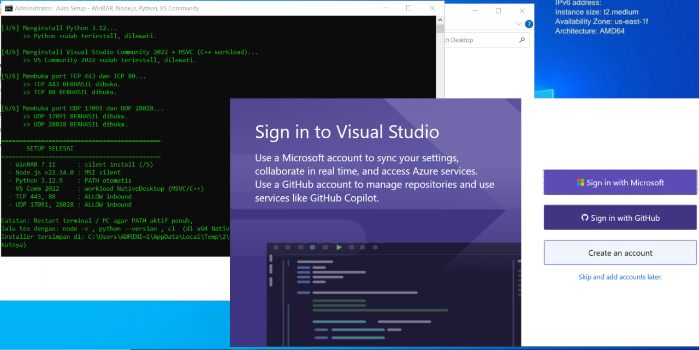

# Auto-setup-GTPS



Script `.bat` untuk auto setup Windows dalam sekali jalan: install aplikasi penting + buka port firewall, tanpa perlu winget.s

## Fitur

| # | Komponen | Metode |a
|---|----------|--------|
| 1 | Google Chrome | MSI enterprise offline (`msiexec /qn`) |
| 2 | WinRAR 7.11 | Silent install `/S` |
| 3 | Node.js v22.14.0 LTS | MSI silent |
| 4 | Python 3.12.9 | Silent + PATH otomatis |
| 5 | Visual Studio Community 2022 | Workload NativeDesktop (MSVC / C++) |
| 6 | Port TCP 443 & 80 | Firewall inbound rule via netsh |
| 7 | Port UDP 17091 & 28028 | Firewall inbound rule via netsh |

## Cara Pakai

1. Download / clone repo ini
2. Klik kanan `auto-setup.bat` → **Run as administrator** (wajib, untuk membuka port)
3. Tunggu sampai selesai — installer yang besar (VS Community) bisa 15–45 menit
4. Restart terminal / PC agar PATH aktif penuh

Tes hasil install:

```bat
node -v
python --version
```

Untuk MSVC, gunakan **x64 Native Tools Command Prompt for VS 2022**, lalu jalankan `cl`..

## Smart Filtering (Skip Otomatis)

- Aplikasi yang **sudah terinstall** → dilewati (cek path instalasi / `where`)
- Installer yang **sudah didownload** → tidak didownload ulang
- Semua installer tersimpan di `%TEMP%\autosetup_download`

## Persyaratan

- Windows 10 / 11
- Hak akses Administrator
- Koneksi internet (installer didownload langsung dari situs resmi: google.com, rarlab.com, nodejs.org, python.org, aka.ms)

## Kustomisasi

Edit bagian URL di dalam `auto-setup.bat`:

```bat
:: Ganti versi Node.js
call :Download "https://nodejs.org/dist/v22.14.0/node-v22.14.0-x64.msi" ...

:: Ganti versi Python
call :Download "https://www.python.org/ftp/python/3.12.9/python-3.12.9-amd64.exe" ...

:: Ganti port TCP/UDP
netsh advfirewall firewall add rule name="..." ... localport=443 ...
```

Menambah workload Visual Studio lain:

```bat
--add Microsoft.VisualStudio.Workload.ManagedDesktop --includeRecommended
```

## Troubleshooting

- `'Firewall' is not recognized` → file corrupt saat copy, pastikan line ending CRLF dan jalankan ulang
- `winget not found` → script ini memang tidak pakai winget, aman
- VS Community kode error `3010` → sukses, tapi perlu restart PC
- Python/Node tidak dikenali setelah install → buka terminal baru atau restart PC

## Disclaimer

Script membuka port inbound di firewall (TCP 443, 80; UDP 17091, 28028). Pastikan kamu paham risikonya dan hanya gunakan di jaringan terpercaya.
